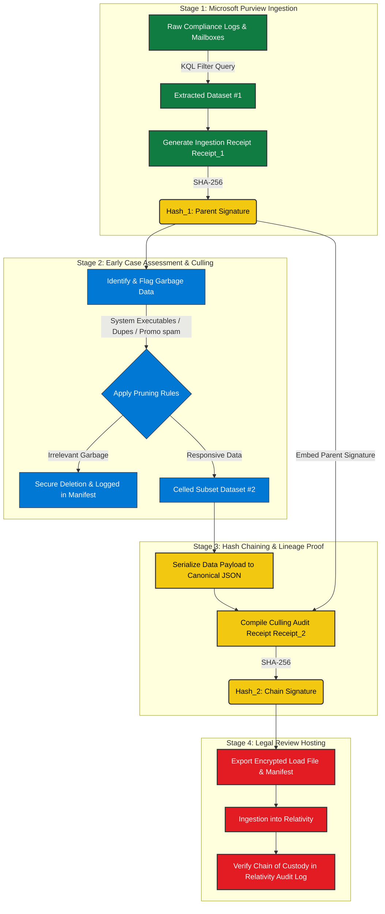

# Robust Data Validation and Defensible Chain of Custody Pipeline

This repository contains the complete technical specifications, architectural designs, and implementation standards for building production-grade data pipelines using **Pydantic V2** and **Microsoft Purview (KQL)**. It details how to ingest complex, nested datasets from Microsoft 365, validate them under strict compliance constraints, and generate defensible, cryptographically bound audit logs for legal admissibility (Early Case Assessment & Culling).

---

## Table of Contents
1. [Project Overview & Workflow](#1-project-overview--workflow)
2. [Pydantic V2 Architecture & Core Concepts](#2-pydantic-v2-architecture--core-concepts)
   - [Coercion vs. Strict Validation](#coercion-vs-strict-validation)
   - [Advanced Constraints & Complex Typing](#advanced-constraints--complex-typing)
3. [M365 & Microsoft Graph API Schemas](#3-m365--microsoft-graph-api-schemas)
   - [Nested Document Payloads](#nested-document-payloads)
   - [Polymorphic Attachment Parsers](#polymorphic-attachment-parsers)
4. [Legal Chain of Custody & Forensic Integrity](#4-legal-chain-of-custody--forensic-integrity)
   - [The Cryptographic Loop](#the-cryptographic-loop)
   - [In-Place Culling & Query Binding](#in-place-culling--query-binding)
5. [Interactive Reports & Audit PDF Certificates](#5-interactive-reports--audit-pdf-certificates)

---

## 1. Project Overview & Workflow
In corporate compliance and litigation environments, datasets retrieved from enterprise clouds (like Microsoft 365 via Microsoft Graph) are highly unstructured, nested, and massive. To host this data in review platforms like **Relativity**, organizations must prune (cull) irrelevant system logs and spam while strictly proving that no evidence was tampered with or modified during the process.

This repository provides a solution that bridges the gap between raw cloud-layer filtering (**KQL**) and secure application-layer validation (**Pydantic**), wrapped in a mathematically proven cryptographic chain of custody.

### Defensible E-Discovery Pipeline
The entire data lifecycle from enterprise cloud ingestion to court-admissible review hosting follows this sequential, hash-chained pipeline:



---

## 2. Pydantic V2 Architecture & Core Concepts

### Coercion vs. Strict Validation
By default, Pydantic will attempt to safely coerce compatible types (e.g., converting a string `"25"` into an integer `25`). However, in forensic and financial applications, coercion can lead to data contamination.

We enforce explicit type configurations using `ConfigDict` or `StrictInt` to prevent implicit data mutability:

```python
from pydantic import BaseModel, ConfigDict, StrictInt

class StrictUserModel(BaseModel):
    model_config = ConfigDict(strict=True)
    
    name: str
    age: StrictInt
    email: str
```

### Advanced Constraints & Complex Typing
Pydantic coordinates standard Python type annotations at runtime to build lightning-fast compiled validation trees in **Rust (`pydantic-core`)**. This configuration handles:
- **Custom Field Validators:** Performing granular business logic assertions before/after standard parsing.
- **Immutable Fields:** Freezing sensitive fields (`frozen=True`) to maintain data integrity.
- **Literals & Enums:** Restricting values to deterministic sets, with `Literal` types offering up to 3.5x faster evaluation speeds than standard Python `Enum` values.

---

## 3. M365 & Microsoft Graph API Schemas

### Nested Document Payloads
Microsoft Graph API returns deep, highly-nested JSON responses. Pydantic's alias matching (`populate_by_name=True`) resolves the naming discrepancy between Python's snake_case style and Microsoft's camelCase API format:

```python
class EmailAddress(BaseModel):
    name: str
    address: EmailStr

class Recipient(BaseModel):
    email_address: EmailAddress = Field(alias="emailAddress")
```

### Polymorphic Attachment Parsers
In M365 datasets, an attachment can be a standard physical payload (e.g., base64 bytes) or a OneDrive reference link (`#microsoft.graph.referenceAttachment`). By employing Pydantic's `Union` together with a `discriminator` field, we polymorphicly parse incoming attachment structures with strict URL validation:

```python
class AttachmentParser(BaseModel):
    attachment: Union[FileAttachment, OneDriveReferenceAttachment] = Field(discriminator="type")
```

---

## 4. Legal Chain of Custody & Forensic Integrity

### The Cryptographic Loop
To satisfy judicial requirements for computer-generated evidence, we prove that the output of our parsing engine matches the ingestion source bit-for-bit. We achieve this by calculating and matching SHA-256 hashes of the raw input and canonical serialized output:

$$\\text{Ingestion SHA-256 Hash} \\equiv \\text{Canonical Exported SHA-256 Hash}$$

### In-Place Culling & Query Binding
When executing in-place culling within Microsoft Purview, records are removed before extraction. To prove that these records were not maliciously deleted, we cryptographically bind the **KQL Query Filter** directly to the **Dataset Payload**. This results in an unbreakable, unified Ingestion Receipt Signature:

```python
class BoundAuditReceipt(BaseModel):
    kql_filter_query: str = Field(alias="KqlFilterQuery")
    executed_by: str = Field(alias="ExecutedBy")
    execution_timestamp: datetime = Field(alias="ExecutionTimestamp")
    record_count: int = Field(alias="RecordCount")
    records: list[dict] = Field(alias="Records")
```

---

## 5. Interactive Reports & Audit PDF Certificates

This package includes tools to generate publication-quality, lawyer-friendly **ECA Disposition Certificates** directly in both HTML and PDF formats.

### Features:
* **HTML Live Visualization:** Renders rich visual components including KPI cards, KQL logic containers, and verified status badges directly in notebooks.
* **Standardized PDF Generation:** Compiles clean, print-ready, high-fidelity PDF documents using standard fonts (Helvetica/Arial) and strict margins via `xhtml2pdf`.
* **Hash-chained Embeddings:** Dynamically incorporates cryptographic SHA-256 signatures to bind physical or digital evidence packages directly to the document footer.

### Generating the PDF Certificate
To generate your own local audit trail certificates, run the validation script:
```bash
pip install pydantic email-validator xhtml2pdf
python render_disposition_report.py
```
This processes the certified receipt schemas and outputs a defensible PDF artifact at: `/content/ECA_Disposition_Report.pdf`.

---

## License
This project is licensed under the MIT License - see the LICENSE file for details.
"""

print(readme_markdown)
